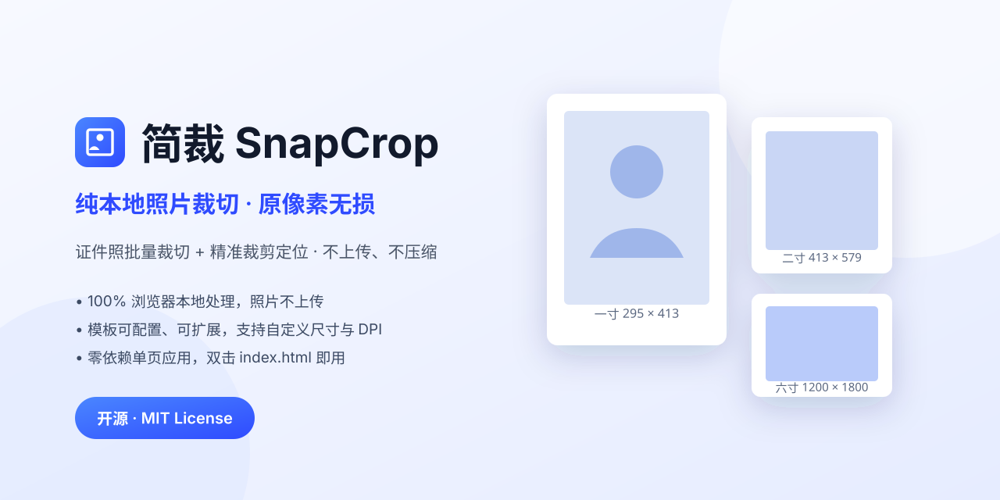

# 简裁 · SnapCrop

> **纯本地、零上传的照片裁切工具。** 两种模式：**照片批量**（一寸到十二寸等模板，拖动/缩放/旋转，一键批量导出）与**精准裁切**（固定裁剪框定位，按**原图像素 1:1 无损导出**）。

[](./LICENSE)
[](#技术选型)
[](#项目结构)
[](./CONTRIBUTING.md)

[English](#english) | [简体中文](#简体中文)

<p align="center">
  
</p>

---

## 简体中文

### 一、项目简介

证件照、报名照、签证照的处理长期依赖在线工具——照片要上传到别人的服务器，隐私与批量效率都不可控。SnapCrop 用浏览器原生的 Canvas 能力把这件事搬回本地：

- **不上传**：所有解码、裁切、编码都在你的浏览器里完成，没有后端，没有网络请求。
- **不安装**：零依赖单页应用，双击 `index.html` 即可使用，也可以托管到任何静态服务器。
- **批量化**：一次导入几十上百张，调好一张的构图即可「应用到全部」，微调后统一导出 ZIP。

适合：教务/人事批量处理证件照、摄影工作室出片、社媒批量裁图、以及任何「不想把照片传给第三方」的场景。

### 二、功能特性

| 类别 | 能力 |
| --- | --- |
| **模式一 · 照片批量** | 一次导入上百张，套用尺寸模板，构图可「应用到全部」，批量导出 ZIP |
| **模式二 · 精准裁切** | 单张图片、固定裁剪框定位：裁剪框尺寸即输出像素，拖动定位 + 视图缩放，**按原图像素 1:1 导出**，不压缩、不重采样、不二次编码 |
| 导入 | 文件选择、拖拽整页投放、`Ctrl/⌘ + V` 剪贴板粘贴；支持 JPG / PNG / WebP / BMP / GIF / AVIF |
| 尺寸模板 | 内置 31 个模板：一寸至大二寸、身份证、驾驶证、护照/签证、3R–10R 冲印（5–12 寸）等；卡片统一显示 `宽 × 高 mm`，冲印尺寸额外标注英寸，可自由扩展 |
| 自定义 | 宽高可切换「毫米 / 像素」，支持锁定比例，DPI 可选 150 / 200 / 300 / 350 / 600 |
| 编辑 | 鼠标拖动移动、滚轮或滑杆缩放（100%–800%）、任意角度旋转 + 一键 90°、水平镜像、三分线 / 中心 / 证件照构图参考线 |
| 批量 | 「应用到全部」同步构图参数；「✓ 确认并下一张」逐张复核；可选仅导出已确认项 |
| 导出 | JPG / PNG / WebP，质量可调，背景色填充或 PNG 透明底，ZIP 打包或逐张下载，文件名模板可配 |
| 体验 | 横版竖版自动纠正方向、深色模式、响应式三栏（桌面）与堆叠（移动端）、快捷键操作、参数本地持久化 |

### 三、快速开始

三种方式任选其一，无需安装任何依赖：

```bash
# 方式 1：直接打开（最简单）
# 双击 index.html 即可（推荐 Chrome / Edge / Firefox 最新版）

# 方式 2：本地静态服务器（推荐，功能最完整）
python serve.py            # 默认 http://127.0.0.1:5173
# 或
npm start                  # 等价，调用上面的 python 脚本
npx --yes serve .          # 若机器上没有 Python

# 方式 3：部署为静态站点
# 把整个目录 push 到 GitHub Pages / Vercel / Netlify 均可，无需构建
```

> 说明：`file://` 协议下绝大多数功能可用；但部分浏览器会限制剪贴板读取与本地存储，因此开发与截图建议使用方式 2。

### 四、两种模式的区别（为什么保留两个入口）

| 维度 | 照片批量 | 精准裁切 |
| --- | --- | --- |
| **定位** | 流水线：把一堆照片统一成「指定规格」 | 精修：从一张照片里精确取出「一块区域」 |
| **使用场景** | 教务/人事批量出证件照、冲印店出片、社媒批量裁图 | 取证截图、投稿裁剪、需要保留原始像素的精修 |
| **输入 / 输出** | 多张进 → ZIP 出 | 单张进 → 单张出 |
| **输出尺寸由谁决定** | 尺寸模板（25×35mm @300dpi → 295×413px） | 裁剪框本身（框多大就输出多大） |
| **是否重采样** | 是。图片按模板缩放（可旋转、可留白约束） | 否。源矩形 = 目标矩形，1:1 拷贝原像素 |
| **实现方式** | 图片适配框：框固定，对图做 scale/rotate/translate | 框选区域：图按视图缩放显示，框 = 原图上的矩形窗口 |
| **格式策略** | JPG/PNG/WebP + 质量，DPI 可配 | PNG 无损优先，可沿用原格式（JPEG/WebP 质量 1.0） |

**去重结论：保留两个入口，但消除重复建设。** 二者输出语义不可互相替代（重采样 vs 1:1），强行合并会让参数面板同时出现「模板 / DPI / 批量 / ZIP」与「裁剪框 / 原像素」，违背「操作流程简单清晰」。
已做的去重动作：**精准裁切复用照片批量的模板库**（右侧「套用模板」下拉，选中即把模板像素填入裁剪框），尺寸配置只有一份数据源（`presets.js`）。

> 顺带说明改名：「证件照批量」→「照片批量」。模板库早已覆盖冲印（3R–10R）、社媒（1080²、9:16、16:9）、A4 等，远超"证件照"范畴，原名会误导用户以为只能做证件照。

### 五、使用流程

顶栏可切换两种模式：**照片批量** / **精准裁切**。

#### 模式一：照片批量

1. **导入** — 点击「导入照片」或把图片拖进窗口（可一次多张，横版竖版混在一起也可以）。
2. **选模板** — 在右侧「尺寸模板」中点选，例如「一寸」；也可在「自定义尺寸」中手动输入宽高与 DPI。
3. **调构图** — 中间画布上：拖动移动照片、滚轮缩放、拖滑杆旋转；需要时点「应用到全部」把构图同步给所有照片。
4. **逐张复核** — 按 `Enter` 或点「✓ 确认并下一张」标记已确认的照片（列表项出现绿点）。
5. **导出** — 设置输出格式/质量/背景色与打包方式，点「批量裁切并导出」，得到一个 ZIP 压缩包。

#### 快捷键

| 按键 | 作用 | 按键 | 作用 |
| --- | --- | --- | --- |
| `←` `→` `↑` `↓` | 移动照片（`Shift` 加速 10 倍） | `[` `]` | 上一张 / 下一张 |
| `+` `-` | 放大 / 缩小 | `,` `.` | 旋转 −1° / +1° |
| `F` | 适应裁切框 | `Enter` | 确认当前并跳下一张 |
| `Delete` | 移除当前照片 | 双击画布 | 重置当前照片变换 |

#### 模式二：精准裁切（原像素无损）

1. **选图** — 左侧点击或拖入单张图片（也支持 `Ctrl/⌘ + V` 粘贴）。
2. **定尺寸** — 右侧设置裁剪框宽高（**单位即输出像素**），可锁定比例或用快捷比例 1:1 / 4:3 / 16:9 等。
3. **定位** — 在预览区拖动图片选择位置，滚轮或滑杆调整**视图缩放**（仅影响预览，不影响输出）；框外遮罩暗化，右下「框内效果」实时同步。
4. **导出** — 点「确定并下载」，浏览器本地生成 PNG（或沿用原格式）并下载，**不经过服务器、不改动原文件**。

边界处理：图片小于裁剪框时自动按比例收敛裁剪尺寸（或勾选「允许留白」输出留白图）；超大图预览只绘制视口可见区域、导出前内存预警；「取消」清空状态，「重新选择」直接换图。

> 为什么能保证无损：导出时用 `drawImage(源矩形, 目标矩形)`，两者**尺寸恒等**，且关闭图像平滑，因此是原图像素的直接拷贝；输出优先 PNG（无损），选择「沿用原格式」时使用 JPEG/WebP 质量 1.0。

### 六、内置尺寸模板（节选）

| 分组 | 模板 | 物理尺寸 | 像素 @300dpi |
| --- | --- | --- | --- |
| 常用证件照 | 一寸 | 25 × 35 mm | 295 × 413 |
| 常用证件照 | 小一寸 | 22 × 32 mm | 260 × 378 |
| 常用证件照 | 大一寸 | 33 × 48 mm | 390 × 567 |
| 常用证件照 | 二寸 | 35 × 49 mm | 413 × 579 |
| 常用证件照 | 小二寸 / 大二寸 | 35 × 45 / 35 × 53 mm | 413 × 531 / 413 × 626 |
| 常用证件照 | 身份证 / 社保卡 | 26 × 32 mm | 358 × 441 |
| 签证 / 出入境 | 中国护照、港澳及台湾通行证 | 33 × 48 mm | 390 × 567 |
| 签证 / 出入境 | 美国签证 | 51 × 51 mm | 600 × 600 |
| 签证 / 出入境 | 日本签证 | 45 × 45 mm | 531 × 531 |
| 签证 / 出入境 | 申根 / 英国签证 | 35 × 45 mm | 413 × 531 |
| 冲印照片 | 3 寸 (2.5×3.5 英寸) | 63.5 × 88.9 mm | 750 × 1050 |
| 冲印照片 | 4 寸 (3×4 英寸) | 76.2 × 101.6 mm | 900 × 1200 |
| 冲印照片 | 5 寸 (3R, 3.5×5 英寸) | 88.9 × 127 mm | 1050 × 1500 |
| 冲印照片 | 6 寸 (4R, 4×6 英寸) | 101.6 × 152.4 mm | 1200 × 1800 |
| 冲印照片 | 7 寸 (5R, 5×7 英寸) | 127 × 177.8 mm | 1500 × 2100 |
| 冲印照片 | 8 寸 (6R, 6×8 英寸) | 152.4 × 203.2 mm | 1800 × 2400 |
| 冲印照片 | 10 寸 (8R, 8×10 英寸) | 203.2 × 254 mm | 2400 × 3000 |
| 冲印照片 | 12 寸 (10R, 10×12 英寸) | 254 × 304.8 mm | 3000 × 3600 |
| 社交与通用 | 方形头像 / 1080 方图 / 9:16 / 16:9 / A4 | — | 295² / 1080² / 1080×1920 / 1920×1080 / 2480×3508 |

> 各地证件照规范会调整，实际提交前请以官方最新公告为准；SnapCrop 提供的是常用经验值。

### 七、照片信息（EXIF）

两种模式下都有可折叠的「照片信息（EXIF）」面板（批量模式：左侧列表下方；精准裁切：左侧图片区），统一展示 4 组字段，**缺失项显示 `—`**：

| 分组 | 字段 |
| --- | --- |
| 文件 | 文件名、格式、体积、像素尺寸、方向 |
| 拍摄设备 | 设备型号（厂商 + 型号）、镜头、处理软件 |
| 拍摄参数 | 拍摄时间、光圈、快门、ISO、焦距、等效焦距、曝光补偿、闪光、测光模式 |
| 位置信息 | 坐标（十进制度 + N/S/E/W）、海拔；有 GPS 时提供「在地图中查看拍摄位置」链接 |

- 解析在浏览器本地完成，零依赖手写 EXIF 解析器（`assets/js/metadata.js`），支持 JPEG（APP1）、PNG（eXIf 块）、WebP（EXIF 块）
- 坐标仅在照片自带 GPS 时存在；被社交软件压缩过的照片通常已被剥离 EXIF，此时整组显示占位符
- 地图链接是用户主动点击才跳转（高德 URI），应用自身不发起任何网络请求
- 批量模式为**懒加载 + 缓存**：切换到哪张才解析哪张，不会一次性读取上百个文件

### 八、配置说明

尺寸模板是完全配置化的，有三个层级，优先级从低到高：

1. **内置模板** — `assets/js/presets.js` 中的 `SC.PRESETS` 数组，追加一条即可新增模板：

   ```js
   { id: 'my-badge', name: '工作牌', group: '自定义', unit: 'mm', w: 54, h: 86, dpi: 300, desc: '胸牌内页' }
   ```

   - `unit: 'mm'` 时按 `dpi` 换算像素（`px = mm ÷ 25.4 × dpi`）；
   - `unit: 'px'` 时直接使用 `w / h` 作为输出像素，忽略 DPI。

2. **外部配置文件** — `config/presets.json` 是与界面导入格式一致的示例（数组）。在界面右侧「尺寸模板 → 导入」选择该文件即可批量载入。

3. **用户自定义模板** — 界面中「保存为我的模板」写入 `localStorage`（键名 `snapcrop.customPresets.v1`），不会污染仓库代码。

其余持久化配置位于 `localStorage` 键 `snapcrop.settings.v1`（当前模板、DPI、输出格式、质量、背景色、视图选项）。

**输出文件命名**支持变量：`{name}` 原文件名、`{preset}` 模板名、`{w}` `{h}` 输出像素、`{dpi}`、`{index}` 两位序号。默认 `{name}_{preset}_{w}x{h}`。

### 九、项目结构

```
snapcrop/
├── index.html                 # 单页应用入口（三栏布局）
├── assets/
│   ├── css/style.css          # 样式：CSS 变量主题、响应式三栏
│   ├── js/
│   │   ├── utils.js           # DOM / 数学 / 下载 / 本地存储等工具
│   │   ├── presets.js         # 尺寸模板配置与像素换算、自定义模板持久化
│   │   ├── zip.js             # 零依赖 ZIP 打包（store 模式 + CRC32）
│   │   ├── importer.js        # 导入：选择 / 拖拽 / 粘贴，解码与缩略图
│   │   ├── editor.js          # 核心：变换模型、绘制、指针与滚轮交互
│   │   ├── exporter.js        # 批量渲染、编码、打包导出
│   │   ├── app.js             # 主控：状态、渲染、事件、快捷键、模式切换
│   │   ├── cropper.js         # 精准裁切：固定裁剪框定位 + 原像素 1:1 导出
│   │   └── metadata.js        # EXIF 元数据解析（JPEG/PNG/WebP）与信息面板渲染
│   └── brand/                 # 图标 icon.svg、封面 cover.svg
├── config/presets.json        # 可导入的扩展模板示例
├── tests/run.js               # 零依赖自测：node tests/run.js（66 项断言）
├── docs/                      # 文档与截图规范
├── scripts/                   # 一键发布脚本（bash + Windows .ps1）
├── serve.py                   # 零依赖本地静态服务器
├── package.json               # 元信息与便捷脚本（非运行时依赖）
├── CONTRIBUTING.md  CHANGELOG.md  LICENSE  .gitignore
└── .github/                   # Issue / PR 模板
```

### 十、核心实现简述

**变换模型**（`assets/js/editor.js`）：所有变换都在「输出像素坐标系」下定义，因此预览所见即导出所得。

```
tx, ty    相对裁切框中心的位移（px）
scale     缩放系数（1 = 原图像素）
rotation  旋转角度（度）
zoom      相对「刚好铺满」的倍率（切换模板或旋转时用于保持构图观感）
```

**铺满计算**：旋转后图像的包围盒为 `bw = iw·|cosθ| + ih·|sinθ|`、`bh = iw·|sinθ| + ih·|cosθ|`，
刚好覆盖 W×H 的缩放系数为 `max(W/bw, H/bh)`。默认禁止留白，位移会被 `clampOffset()` 限制在包围盒内，
因此照片边缘永远不会进入裁切框内部。

**导出**：为每张照片创建 W×H 的离屏 Canvas，填充背景色后按同一变换绘制，再 `toBlob()` 编码；
ZIP 由 `zip.js` 手写生成（store 模式，图片本身已压缩，无需再 deflate），避免引入外部依赖。
批量过程逐帧 `await` 让出主线程，界面不会卡死。

### 十一、浏览器兼容性

| 浏览器 | 版本 | 说明 |
| --- | --- | --- |
| Chrome / Edge | ≥ 90 | 完整支持（推荐） |
| Firefox | ≥ 90 | 完整支持 |
| Safari | ≥ 15 | WebP 导出会回退为 JPG |
| 移动端浏览器 | 主流版本 | 布局自动堆叠，支持触摸拖动与双指场景下的单指拖动 |

不支持的文件：HEIC / HEIF（多数浏览器无法解码，请先转换为 JPG）；RAW 格式请先在相机软件中导出。

### 十二、常见问题

**Q：照片会被上传到服务器吗？**
A：不会。项目没有后端，代码中不存在任何上传请求。可用浏览器开发者工具的 Network 面板自行验证。

**Q：导出的照片为什么比原图小？**
A：输出尺寸由模板决定（如 295×413）。若需要更大的图，请提高 DPI 或在自定义尺寸中选择像素单位。

**Q：批量处理会卡死浏览器吗？**
A：不会。渲染逐张进行并在每张之间让出一帧，进度条实时更新且可取消。上百张照片建议分批（每批 ≤ 200 张）处理。

**Q：可以继续编辑上次的参数吗？**
A：可以。当前模板、DPI、输出格式、背景色、视图选项都保存在浏览器 `localStorage` 中，下次打开自动恢复。

**Q：可以在公司内网的静态服务器上部署吗？**
A：可以，整个目录即静态站点，复制到任意 Web 服务器目录即可，无需构建与运行时。

### 十三、路线图

- [ ] 常用背景色预设（白 / 蓝 / 红底）与一键换底（基于简单抠图）
- [ ] 多模板同时输出（一次裁切导出多规格）
- [ ] 人脸检测自动居中构图（WebAssembly / MediaPipe，可选加载）
- [ ] 导出前压缩体积预估与限制
- [ ] 国际化（English UI）

### 十四、贡献指南

欢迎任何形式的贡献：报告缺陷、提出需求、改进文档或提交代码。简要流程：

1. Fork 本仓库并创建分支：`git checkout -b feat/your-feature`
2. 保持**零依赖**原则，修改后请在 Chrome 与 Firefox 中手动验证
3. 提交信息建议遵循 [Conventional Commits](https://www.conventionalcommits.org/)：`feat: 新增 …`
4. 发起 Pull Request，说明改动动机、实现方式与自测结果

详见 [CONTRIBUTING.md](./CONTRIBUTING.md)。

### 十五、发布到 GitHub

仓库描述、标签（topics）、封面图与界面截图规范、Release 与 Pages 配置、首次提交命令，均整理在
[docs/GITHUB.md](./docs/GITHUB.md)。上传前只需把文中的 `Felix5206` 替换为你的 GitHub 用户名。

一句话描述可直接复制：

```
纯本地、零上传的照片裁切工具 · 照片批量裁切 + 原像素无损精准裁切 · 不经过服务器
```

推荐 topics：`photo-crop` `image-crop` `id-photo` `证件照` `batch-processing` `canvas` `vanilla-js` `no-dependency` `privacy` `offline-tool`

### 十六、作者

**Felix（范建亮）** — [GitHub @Felix5206](https://github.com/Felix5206)

计算机基础应用教师 / 苏州深码数创执行董事兼总经理 / 执业律师。本项目源于日常教学与业务中反复出现的
「批量处理证件照、又不想把照片上传到第三方」的需求，因此坚持三条底线：零依赖、零上传、零构建。

欢迎通过 [Issues](https://github.com/Felix5206/snapcrop/issues) 反馈问题，或按
[CONTRIBUTING.md](./CONTRIBUTING.md) 提交 Pull Request。

### 十七、许可证

本项目基于 [MIT License](./LICENSE) 开源。你可以自由使用、修改与分发，包括商业用途，但需保留版权声明。

---

## English

### 1. Introduction

Processing ID photos, application photos and visa photos has long relied on online tools — your photos are uploaded to someone else's server, and neither privacy nor batch efficiency is under your control. SnapCrop brings this back to your machine using the browser's native Canvas capabilities:

- **No uploads** — all decoding, cropping and encoding happen in your browser. There is no backend and no network requests.
- **No installation** — a zero-dependency single-page app. Just double-click `index.html`, or host it on any static server.
- **Batch processing** — import dozens or hundreds of photos at once, compose one and "apply to all", then fine-tune and export everything as a ZIP.

It is ideal for academic/HR staff processing ID photos in bulk, photo studios delivering work, batch cropping for social media, and any scenario where you "don't want to hand your photos to a third party".

### 2. Features

| Category | Capabilities |
| --- | --- |
| **Mode 1 · Batch Photos** | Import hundreds of photos, apply size presets, compose once and "apply to all", export as a ZIP in bulk |
| **Mode 2 · Precision Crop** | A single image with a fixed crop box: the box size is the output size. Position it, adjust the view zoom, and **export at the original pixels 1:1** — no compression, no resampling, no re-encoding |
| Import | File picker, full-page drag & drop, `Ctrl/⌘ + V` paste; supports JPG / PNG / WebP / BMP / GIF / AVIF |
| Size presets | 31 built-in presets: 1-inch to large 2-inch, ID card, driver's license, passport/visa, 3R–10R prints (5–12 inch), etc. Cards uniformly show `W × H mm`, with print sizes additionally marked in inches; freely extensible |
| Custom | Width/height switchable between "mm / px", aspect-ratio lock, DPI options 150 / 200 / 300 / 350 / 600 |
| Editing | Drag to move, mouse wheel or slider to zoom (100%–800%), arbitrary rotation + one-tap 90°, horizontal flip, rule-of-thirds / center / ID-photo composition guides |
| Batch | "Apply to all" syncs composition; "✓ confirm & next" reviews one by one; optionally export only confirmed items |
| Export | JPG / PNG / WebP with adjustable quality, background fill or transparent PNG, ZIP archive or individual downloads, configurable filename template |
| Experience | Auto orientation correction for landscape/portrait, dark mode, responsive three-column (desktop) / stacked (mobile) layout, keyboard shortcuts, local persistence of settings |

### 3. Quick Start

Choose any of the three methods — no dependencies to install:

```bash
# Method 1: Open directly (simplest)
# Double-click index.html (latest Chrome / Edge / Firefox recommended)

# Method 2: Local static server (recommended, most complete)
python serve.py            # default http://127.0.0.1:5173
# or
npm start                  # equivalent, calls the python script above
npx --yes serve .          # if Python is not installed

# Method 3: Deploy as a static site
# Push the whole directory to GitHub Pages / Vercel / Netlify — no build needed
```

> Note: most features work under the `file://` protocol, but some browsers restrict clipboard access and local storage. Use Method 2 for development and screenshots.

### 4. How the Two Modes Differ (Why Keep Both Entries)

| Dimension | Batch Photos | Precision Crop |
| --- | --- | --- |
| **Purpose** | A pipeline: turn a pile of photos into a "specified spec" | Refinement: precisely extract "one region" from a photo |
| **Use case** | Academic/HR batch ID photos, print shops, batch cropping for social media | Evidence screenshots, submission cropping, refinements that must keep original pixels |
| **Input / Output** | Many in → ZIP out | One in → one out |
| **What sets output size** | The size preset (25×35mm @300dpi → 295×413px) | The crop box itself (the box is as large as the output) |
| **Resampling?** | Yes. The image is scaled to the preset (rotatable, with margin constraints) | No. Source rectangle = target rectangle, a 1:1 copy of original pixels |
| **Implementation** | Image fits the box: the box is fixed, the image gets scale/rotate/translate | Box-selected region: the image is shown at view zoom, the box = a rectangular window on the original |
| **Format strategy** | JPG/PNG/WebP + quality, configurable DPI | PNG lossless first, can keep the original format (JPEG/WebP quality 1.0) |

**Dedup conclusion: keep both entries, but eliminate duplicated work.** Their output semantics are not interchangeable (resampling vs 1:1). Forcing them together would make the parameter panel show both "preset / DPI / batch / ZIP" and "crop box / original pixels", violating "a simple, clear workflow".

Dedup already done: **precision crop reuses the batch preset library** (the "apply preset" dropdown on the right fills the crop box with a preset's pixels), and there is a single data source for size configuration (`presets.js`).

> A note on the rename: "ID photo batch" → "batch photos". The preset library already covers prints (3R–10R), social media (1080², 9:16, 16:9), A4 and more — far beyond ID photos. The old name mislead users into thinking it only handled ID photos.

### 5. Workflows

Use the top bar to switch between **Batch Photos** / **Precision Crop**.

#### Mode 1: Batch Photos

1. **Import** — Click "Import photos" or drag images into the window (multiple at once, mixed landscape and portrait fine).
2. **Choose a preset** — Click one in "Size presets" on the right, e.g. "1-inch"; or manually enter width/height and DPI under "Custom size".
3. **Compose** — On the center canvas: drag to move, wheel to zoom, slider to rotate; click "apply to all" when needed to sync the composition to every photo.
4. **Review one by one** — Press `Enter` or click "✓ confirm & next" to mark confirmed photos (a green dot appears on the list item).
5. **Export** — Set output format/quality/background and packaging, then click "Batch crop & export" to get a ZIP archive.

#### Keyboard shortcuts

| Key | Action | Key | Action |
| --- | --- | --- | --- |
| `←` `→` `↑` `↓` | Move the photo (`Shift` = 10× faster) | `[` `]` | Previous / next photo |
| `+` `-` | Zoom in / out | `,` `.` | Rotate −1° / +1° |
| `F` | Fit to crop box | `Enter` | Confirm current & next |
| `Delete` | Remove current photo | Double-click canvas | Reset current photo transform |

#### Mode 2: Precision Crop (original-pixel lossless)

1. **Pick an image** — Click on the left or drag in a single image (also supports `Ctrl/⌘ + V` paste).
2. **Set size** — Set the crop box width/height on the right (**the unit is the output pixel**), lock the ratio or use quick ratios 1:1 / 4:3 / 16:9.
3. **Position** — Drag the image in the preview to choose a position, wheel or slider to adjust the **view zoom** (preview only, does not affect output); the area outside the box is darkened, and the "in-box result" syncs live at the bottom right.
4. **Export** — Click "OK & download" to generate a PNG (or keep the original format) locally and download it — **no server involved, original file untouched**.

Boundary handling: when the image is smaller than the crop box, the crop size is auto-scaled proportionally (or enable "allow margins" to output a margined image); for oversized images only the visible viewport is drawn in the preview, with a memory warning before export; "Cancel" clears the state, and "Re-select" swaps the image directly.

> Why lossless is guaranteed: on export, `drawImage(source rectangle, target rectangle)` is used with **identical dimensions** and image smoothing disabled, so it is a direct copy of the original pixels. PNG (lossless) is preferred; when "keep original format" is chosen, JPEG/WebP quality 1.0 is used.

### 6. Built-in Size Presets (Excerpt)

| Group | Preset | Physical size | Pixels @300dpi |
| --- | --- | --- | --- |
| Common ID photos | 1-inch | 25 × 35 mm | 295 × 413 |
| Common ID photos | Small 1-inch | 22 × 32 mm | 260 × 378 |
| Common ID photos | Large 1-inch | 33 × 48 mm | 390 × 567 |
| Common ID photos | 2-inch | 35 × 49 mm | 413 × 579 |
| Common ID photos | Small 2-inch / Large 2-inch | 35 × 45 / 35 × 53 mm | 413 × 531 / 413 × 626 |
| Common ID photos | ID card / social-security card | 26 × 32 mm | 358 × 441 |
| Visa / border | Chinese passport, HK/Macau/Taiwan permits | 33 × 48 mm | 390 × 567 |
| Visa / border | US visa | 51 × 51 mm | 600 × 600 |
| Visa / border | Japan visa | 45 × 45 mm | 531 × 531 |
| Visa / border | Schengen / UK visa | 35 × 45 mm | 413 × 531 |
| Print photos | 3 inch (2.5×3.5 in) | 63.5 × 88.9 mm | 750 × 1050 |
| Print photos | 4 inch (3×4 in) | 76.2 × 101.6 mm | 900 × 1200 |
| Print photos | 5 inch (3R, 3.5×5 in) | 88.9 × 127 mm | 1050 × 1500 |
| Print photos | 6 inch (4R, 4×6 in) | 101.6 × 152.4 mm | 1200 × 1800 |
| Print photos | 7 inch (5R, 5×7 in) | 127 × 177.8 mm | 1500 × 2100 |
| Print photos | 8 inch (6R, 6×8 in) | 152.4 × 203.2 mm | 1800 × 2400 |
| Print photos | 10 inch (8R, 8×10 in) | 203.2 × 254 mm | 2400 × 3000 |
| Print photos | 12 inch (10R, 10×12 in) | 254 × 304.8 mm | 3000 × 3600 |
| Social & general | Square avatar / 1080 square / 9:16 / 16:9 / A4 | — | 295² / 1080² / 1080×1920 / 1920×1080 / 2480×3508 |

> ID-photo specs vary by region and are updated. Please rely on the latest official announcement before submitting; SnapCrop provides common rule-of-thumb values.

### 7. Photo Info (EXIF)

Both modes have a collapsible "Photo info (EXIF)" panel (batch mode: below the list on the left; precision crop: in the image area on the left), uniformly showing 4 field groups, with **missing items shown as `—`**:

| Group | Fields |
| --- | --- |
| File | Filename, format, size, pixel dimensions, orientation |
| Capture device | Device model (maker + model), lens, processing software |
| Capture params | Capture time, aperture, shutter, ISO, focal length, equivalent focal length, exposure compensation, flash, metering mode |
| Location | Coordinates (decimal degrees + N/S/E/W), altitude; when GPS is present, a "view capture location on map" link |

- Parsing is done locally in the browser with a zero-dependency hand-written EXIF parser (`assets/js/metadata.js`), supporting JPEG (APP1), PNG (eXIf chunk) and WebP (EXIF chunk)
- Coordinates exist only when the photo carries GPS; photos compressed by social apps usually have EXIF stripped, in which case the whole group shows placeholders
- The map link only navigates when the user actively clicks it (Amap URI); the app itself makes no network requests
- Batch mode is **lazy-loaded + cached**: it parses only the photo you switch to, never reading hundreds of files at once

### 8. Configuration

Size presets are fully configuration-driven, with three levels (lowest to highest priority):

1. **Built-in presets** — the `SC.PRESETS` array in `assets/js/presets.js`. Append one entry to add a preset:

   ```js
   { id: 'my-badge', name: 'Name badge', group: 'Custom', unit: 'mm', w: 54, h: 86, dpi: 300, desc: 'Badge insert' }
   ```

   - With `unit: 'mm'`, pixels are derived by `dpi` (`px = mm ÷ 25.4 × dpi`);
   - With `unit: 'px'`, `w / h` are used directly as output pixels, ignoring DPI.

2. **External config file** — `config/presets.json` is an example in the same format the UI imports (an array). Use "Size presets → Import" on the right to load it in bulk.

3. **User custom presets** — "Save as my preset" in the UI writes to `localStorage` (key `snapcrop.customPresets.v1`), without polluting the repository code.

Other persistent settings live in the `localStorage` key `snapcrop.settings.v1` (current preset, DPI, output format, quality, background, view options).

**Output filenames** support variables: `{name}` original name, `{preset}` preset name, `{w}` `{h}` output pixels, `{dpi}`, `{index}` two-digit index. Default: `{name}_{preset}_{w}x{h}`.

### 9. Project Structure

```
snapcrop/
├── index.html                 # single-page app entry (three-column layout)
├── assets/
│   ├── css/style.css          # styles: CSS-variable themes, responsive three columns
│   ├── js/
│   │   ├── utils.js           # DOM / math / download / local-storage utilities
│   │   ├── presets.js         # size preset config, pixel conversion, custom-preset persistence
│   │   ├── zip.js             # zero-dependency ZIP packaging (store mode + CRC32)
│   │   ├── importer.js        # import: picker / drag / paste, decoding & thumbnails
│   │   ├── editor.js          # core: transform model, drawing, pointer & wheel interactions
│   │   ├── exporter.js        # batch rendering, encoding, packaging export
│   │   ├── app.js             # controller: state, rendering, events, shortcuts, mode switching
│   │   ├── cropper.js         # precision crop: fixed box positioning + original-pixel 1:1 export
│   │   └── metadata.js        # EXIF parsing (JPEG/PNG/WebP) & info panel rendering
│   └── brand/                 # icon.svg, cover.svg
├── config/presets.json        # importable example of extended presets
├── tests/run.js               # zero-dependency self-test: node tests/run.js (66 assertions)
├── docs/                      # docs & screenshot conventions
├── scripts/                   # one-click publish scripts (bash + Windows .ps1)
├── serve.py                   # zero-dependency local static server
├── package.json               # metadata & convenience scripts (not a runtime dependency)
├── CONTRIBUTING.md  CHANGELOG.md  LICENSE  .gitignore
└── .github/                   # issue / PR templates
```

### 10. Core Implementation Notes

**Transform model** (`assets/js/editor.js`): all transforms are defined in the output-pixel coordinate system, so the preview is exactly what gets exported.

```
tx, ty    offset relative to the crop-box center (px)
scale     zoom factor (1 = original pixels)
rotation  rotation angle (degrees)
zoom      multiplier relative to "just cover" (keeps composition when switching presets or rotating)
```

**Cover calculation**: after rotation, the bounding box is `bw = iw·|cosθ| + ih·|sinθ|`, `bh = iw·|sinθ| + ih·|cosθ|`, and the scale that just covers W×H is `max(W/bw, H/bh)`. Margins are disallowed by default and the offset is constrained within the bounding box by `clampOffset()`, so photo edges never enter the crop box.

**Export**: for each photo an off-screen W×H canvas is created, filled with the background color, drawn with the same transform, then encoded with `toBlob()`; the ZIP is generated by the hand-written `zip.js` (store mode — images are already compressed, no deflate needed), avoiding external dependencies. The batch process yields the main thread per frame with `await`, so the UI never freezes.

### 11. Browser Compatibility

| Browser | Version | Notes |
| --- | --- | --- |
| Chrome / Edge | ≥ 90 | Full support (recommended) |
| Firefox | ≥ 90 | Full support |
| Safari | ≥ 15 | WebP export falls back to JPG |
| Mobile browsers | Mainstream | Layout auto-stacks; supports touch drag and single-finger drag in two-finger scenarios |

Unsupported files: HEIC / HEIF (most browsers cannot decode them — convert to JPG first); for RAW, export from your camera software first.

### 12. FAQ

**Q: Are photos uploaded to a server?**
A: No. There is no backend and no upload request in the code. Verify it yourself with the Network panel in DevTools.

**Q: Why is the exported photo smaller than the original?**
A: Output size is set by the preset (e.g. 295×413). For a larger image, raise the DPI or use pixel units in custom size.

**Q: Does batch processing freeze the browser?**
A: No. Rendering proceeds photo by photo, yielding a frame between each, with a live, cancellable progress bar. For hundreds of photos, process in batches (≤ 200 each).

**Q: Can I continue editing last time's parameters?**
A: Yes. The current preset, DPI, output format, background and view options are stored in the browser's `localStorage` and restored on next open.

**Q: Can I deploy it on a company intranet static server?**
A: Yes. The whole directory is a static site — copy it to any web server directory, no build or runtime needed.

### 13. Roadmap

- [ ] Common background-color presets (white / blue / red) and one-tap background replacement (simple cutout)
- [ ] Multiple presets at once (export several specs in one crop)
- [ ] Face-detection auto-centering (WebAssembly / MediaPipe, optionally loaded)
- [ ] Pre-export size estimate and limits
- [ ] Internationalization (English UI)

### 14. Contributing

Contributions of any kind are welcome: reporting bugs, requesting features, improving docs, or submitting code. Brief flow:

1. Fork the repo and create a branch: `git checkout -b feat/your-feature`
2. Keep the **zero-dependency** principle; after changes, manually verify in Chrome and Firefox
3. Commit messages should follow [Conventional Commits](https://www.conventionalcommits.org/): `feat: add ...`
4. Open a pull request describing the motivation, implementation and self-test results

See [CONTRIBUTING.md](./CONTRIBUTING.md) for details.

### 15. Publishing to GitHub

The repo description, topics, cover image and screenshot conventions, Release and Pages setup, and first-commit commands are collected in
[docs/GITHUB.md](./docs/GITHUB.md). Before uploading, just replace `Felix5206` in the document with your GitHub username.

A ready-to-copy one-line description:

```
A fully local, zero-upload photo cropper · batch photo cropping + original-pixel lossless precision crop · no server involved
```

Recommended topics: `photo-crop` `image-crop` `id-photo` `batch-processing` `canvas` `vanilla-js` `no-dependency` `privacy` `offline-tool`

### 16. Author

**Felix (Fan Jianliang)** — [GitHub @Felix5206](https://github.com/Felix5206)

This project grew out of a recurring need in daily teaching and business — "processing ID photos in bulk without uploading them to a third party" — and therefore holds three lines: zero dependencies, zero uploads, zero build.

Feel free to report issues via [Issues](https://github.com/Felix5206/snapcrop/issues) or submit pull requests per [CONTRIBUTING.md](./CONTRIBUTING.md).

### 17. License

This project is open-sourced under the [MIT License](./LICENSE). You may freely use, modify and distribute it, including commercially, as long as you retain the copyright notice.

---

## Star History

<p align="center">
  <a href="https://star-history.com/#Felix5206/snapcrop&Date">
    
  </a>
</p>
